# Chronotask — design refresh (Nov 2026)

A refinement pass on the existing Swiss/editorial direction rather than a rebrand.
The goal: keep the numbered, typographic character while removing the noise that
made the workspace feel like a developer console.

## Before / after

| Before | After |
| --- | --- |
| 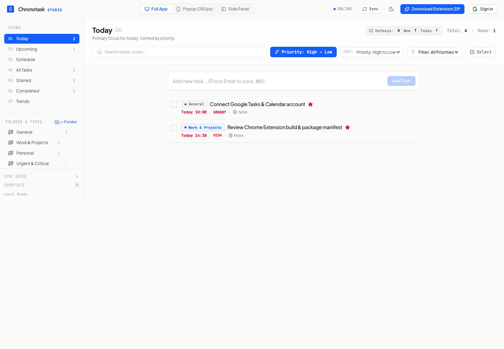 | 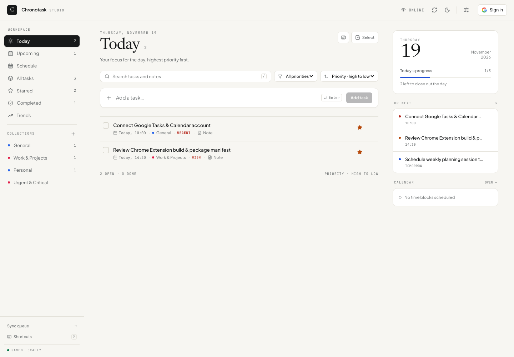 |

Dark theme and task detail:

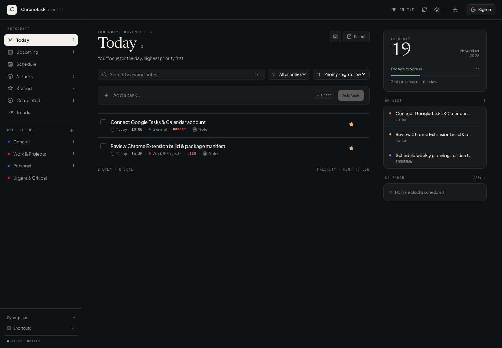

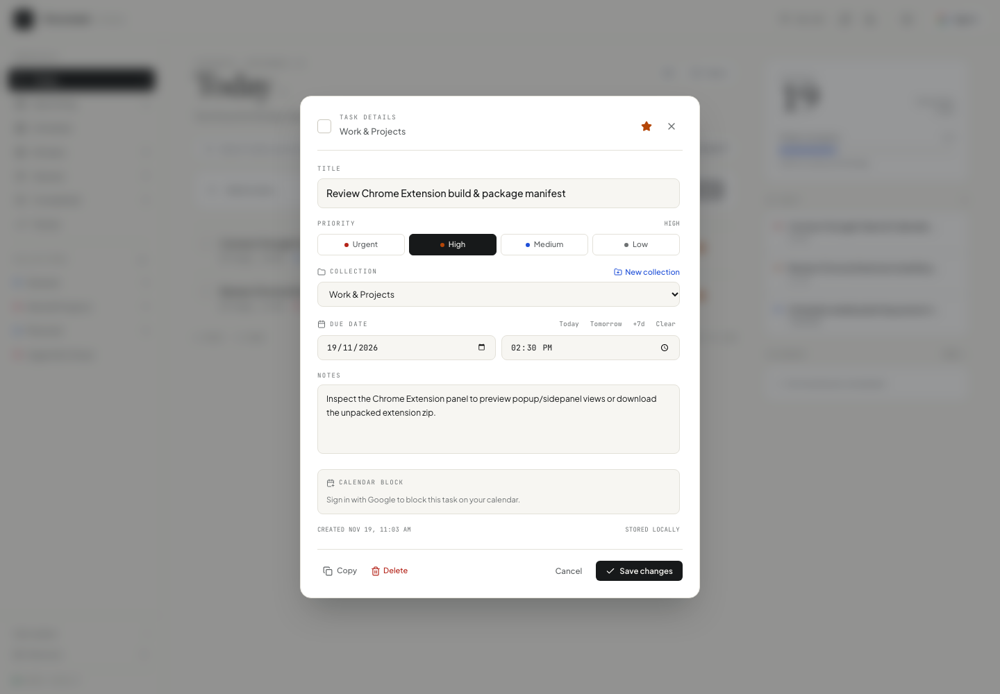

The simulator, extension download, shortcuts and sync queue moved into one tools
menu:

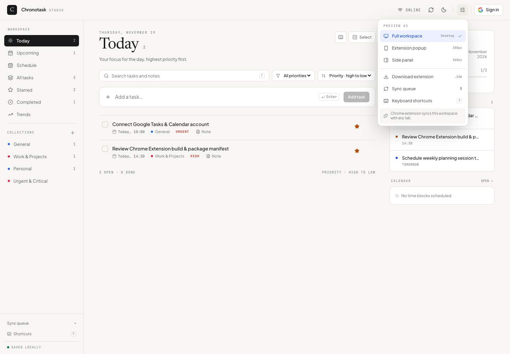

Mobile (390px):

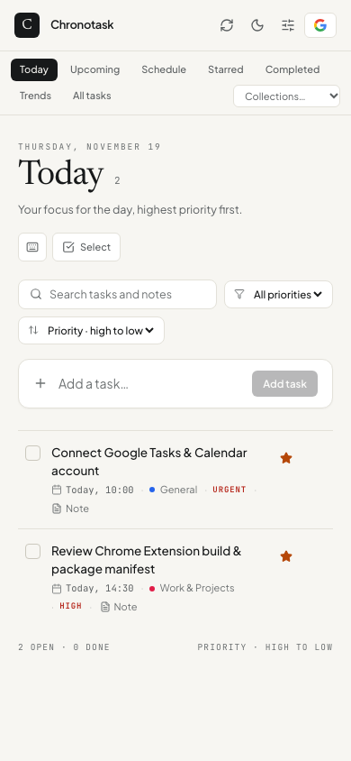

## What was holding the design back

1. **The theme toggle was broken.** `dark:` classes were resolving from the OS
   `prefers-color-scheme`, not the `.dark` class the app toggled. On a dark Mac,
   the app was stuck in dark mode.
2. **Developer chrome in the product shell.** The "Full App / Popup / Side Panel"
   simulator, extension download, hotkey cheatsheet and sync queue all competed
   with the actual task list in the top bar.
3. **Duplicated controls.** Priority was sortable through two different controls,
   the header repeated counts (`Total 4 · Done 1`), and search/filter/sort/select
   sat in one dense row.
4. **Weak hierarchy.** Nearly everything was 10–11px; page title, task title and
   metadata were close in weight and size. The content column was 768px centred
   inside a 1180px area, leaving a large dead zone on the right.
5. **Mixed visual languages.** Numbered mono nav, emoji folders, coloured pills,
   Lucide icons, cobalt used for everything, and rose used for urgent, overdue,
   stars and destructive actions.
6. **No mobile path.** The sidebar was fixed-width and the shell had no compact
   navigation.

## The direction

**Editorial calm.** Warm paper, ink, one cobalt accent, amber reserved for stars,
red strictly for danger/urgent. Serif display type (Newsreader) for page titles,
Plus Jakarta Sans for UI, JetBrains Mono for small labels. Hairlines instead of
borders on boxes; active nav as an ink block, not a blue one.

## What changed

### Design system (`src/index.css`, `index.html`)
- Semantic tokens: `paper`, `surface`, `subtle`, `ink`, `ink-2`, `ink-3`, `line`,
  `accent`, `danger`, `warn`, `ok` for both themes.
- Class-based dark variant, applied to `<html>` before paint, so the toggle works
  and native controls follow the theme (`color-scheme`).
- Contrast bump for `ink-3`, visible focus rings, theme-aware scrollbars.
- Newsreader added for display type.

### Shell (`Navbar`, `Sidebar`)
- Top bar reduced to brand → status/sync/theme → a **Tools** menu → account.
  The simulator, extension download, shortcuts and sync queue now live in that
  menu, out of the daily path.
- Sidebar uses real icons, drops the `01–07` indices and emoji folders, and uses
  colour dots for collections. Counts stay visible; copy/delete appear on hover.
- A compact wrapped view switcher plus collection select appears below the top bar
  under `md`, replacing the hidden sidebar.

### Workspace (`App.tsx`, `ContextRail`)
- Editorial header: date eyebrow, serif title, count, one-line description.
- One search field, one priority filter, one sort control. Removed the duplicate
  "Priority: High → Low" button and the hotkey strip from the header.
- `/` focuses search.
- A right-hand rail (≥1280px) fills the previously dead space with today's
  progress, "Up next" and the next calendar block.
- Empty states are typographic, not dashed boxes.

### Rows and composer (`TaskItem`, `QuickAddBar`)
- 13.5px titles with due/folder/priority/note/sync metadata on one line.
- Row opens the detail sheet; star and a `⋯` menu (edit, calendar, copy, delete)
  replace five always-visible icons. Destructive action is separated.
- Quick add is a single calm line with Enter hint, expanding to date/time/
  priority/calendar controls; ink primary button.

### Detail sheet and batch bar
- Re-skinned to the same tokens: serif-free labels, ink segmented priority,
  paper inputs, ink primary action, amber star.
- Batch bar is a single surface with an ink "Complete" action and a restrained
  danger delete.

### Extension popup and side panel
The Chrome extension carried a second design language: indigo→blue gradient
header, floating cards with shadows, emoji folder tags, and no dark mode. It now
uses the same tokens and rules as the app.

| Before | After |
| --- | --- |
| 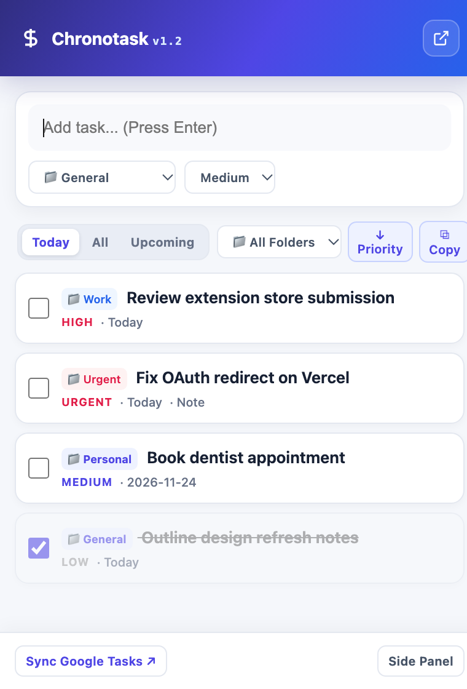 | 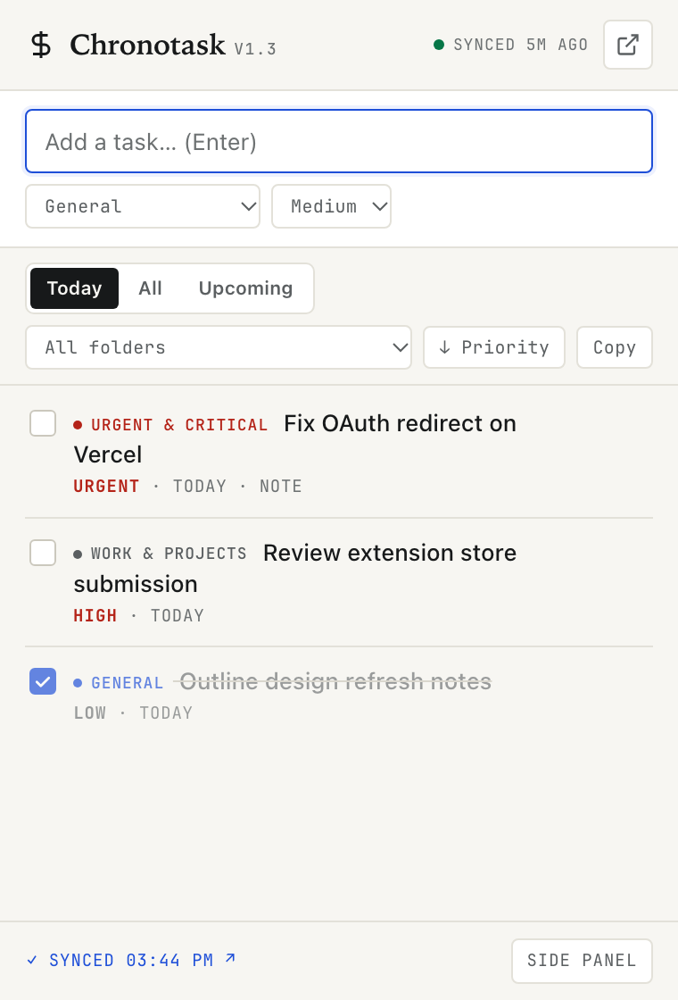 |

Dark mode follows the OS:

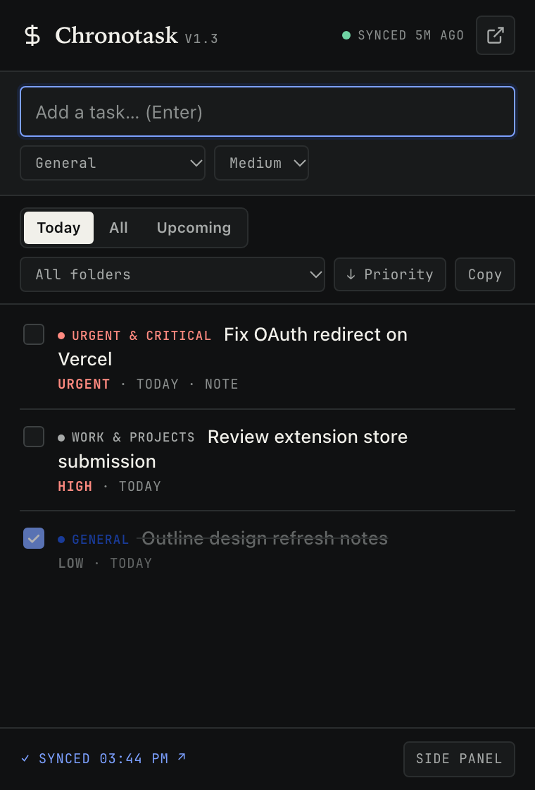

The detail drawer and the side panel reuse the same sheet:

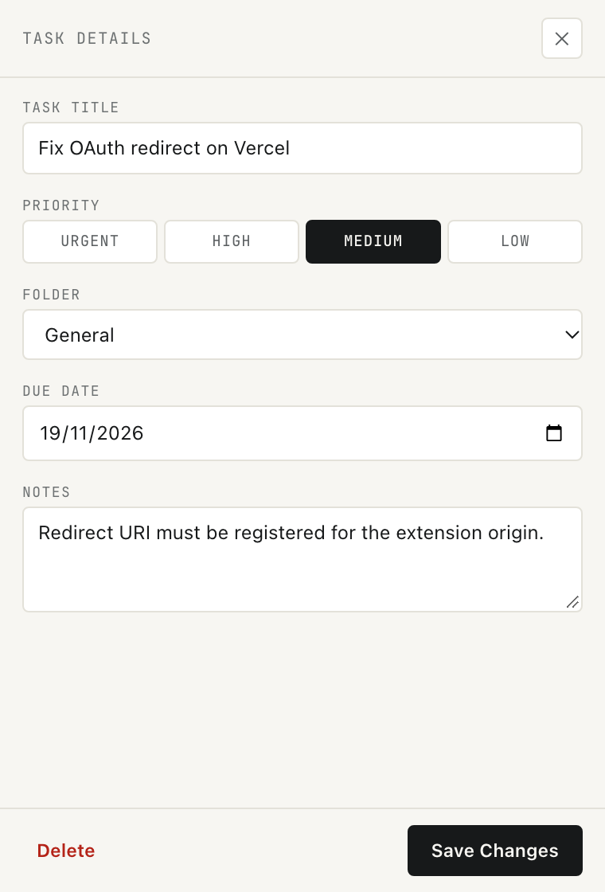

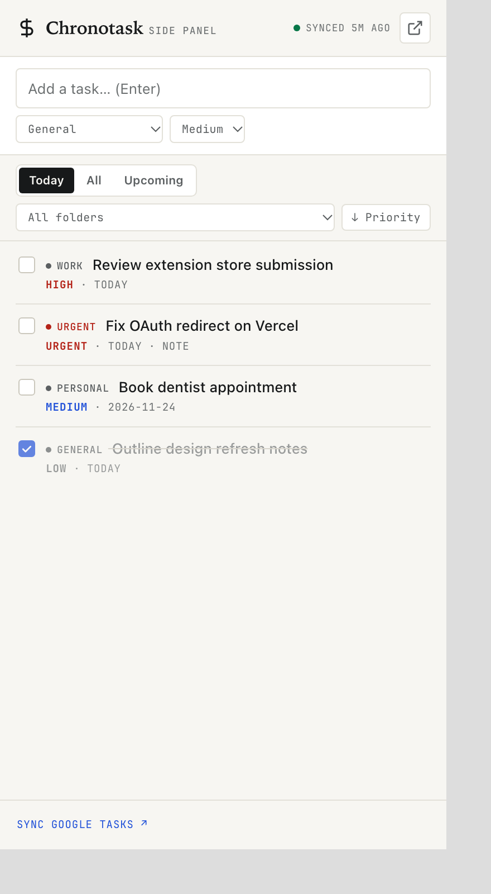

- Flat paper header with the serif wordmark and hairline rules; no gradients,
  no floating cards. One cobalt accent; red only for urgent/overdue.
- Folder tags are mono uppercase with a colour dot (no emoji). Priorities keep
  the app semantics: urgent/high red, medium cobalt, low muted.
- The filter row wraps to two lines, so the folder select, priority toggle and
  copy action no longer clip at 380px.
- Added `prefers-color-scheme` dark tokens, a custom checkbox, visible focus
  rings, and a typographic empty state.
- The popup / side-panel simulator in the app was re-skinned to the same tokens
  and is labelled with the real 380 × 560 popup size.
- The in-app Extension release modal (store answers, file browser, install
  guide) was moved off neutral greys and blue onto the same tokens.

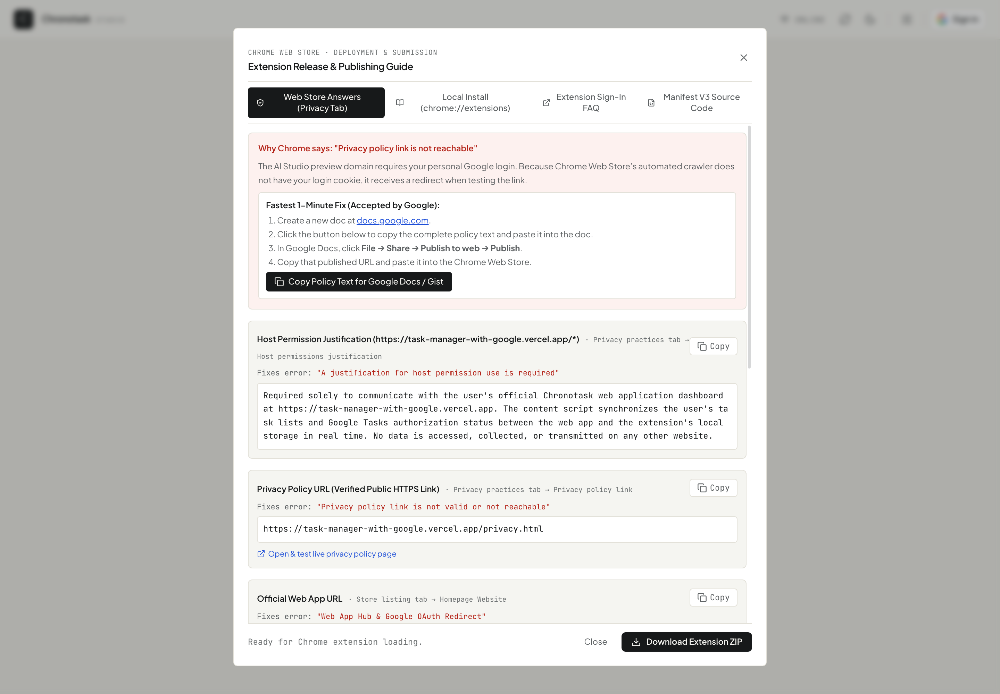
- Version 1.3.0: a sync-state dot and relative time in the header ("Synced 5m
  ago", "Local only", "Offline"), refreshed while the popup is open.
- Keyboard: `/` focuses quick-capture, `Esc` closes the detail drawer,
  `Cmd/Ctrl+Enter` saves it. Focus moves to the title field when the drawer
  opens and back to quick-capture when it closes.
- The completion checkbox has a 26px hit area instead of a bare 15px box, and
  folder badges disappear while a single folder is the active filter.
- Accessibility: 29 controls have accessible names, the drawer is a labelled
  dialog, tabs expose `aria-pressed`, and the sync state is `role="status"`.
- 200% zoom (≈190 CSS px) reflows instead of scrolling sideways: selects stack,
  sort/copy and footer wrap, the copy button and sync label drop out.

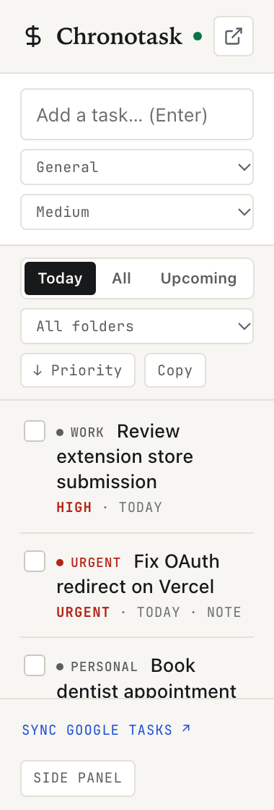

- Contrast audit (WCAG AA, computed against paper): ink 16.3, ink-2 6.0, ink-3
  4.6, accent 6.1, danger 6.1, warn 5.0; completed rows read at 5.8 after the
  opacity change.

## Deliberately left for a follow-up

- `CalendarScheduleView` and `TrendsDashboard` internals still use the older
  neutral/blue palette. They inherit the new shell but should get a pass.
- A proper mobile drawer for collections (the select is a stopgap).
- Replacing native `<select>` with a custom combobox for filter/sort.
- A contrast audit at 200% zoom and with a screen reader.
- Publish v1.3.0: the manifest and store-answer copy are updated, but the
  Chrome Web Store listing still needs fresh screenshots and the manual upload.
- A human screen-reader pass (VoiceOver/NVDA). The DOM audit and labels are in
  place, but no person has walked the popup with a reader yet.


## Verify

```bash
npm run lint   # tsc --noEmit
npm run build
npm run dev    # http://localhost:3000
```

The screenshots above were captured from the running app at 1440×1000 and
390×844 with the seeded sample data.
